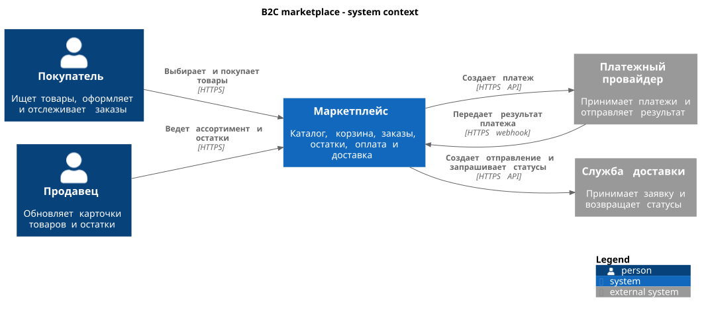
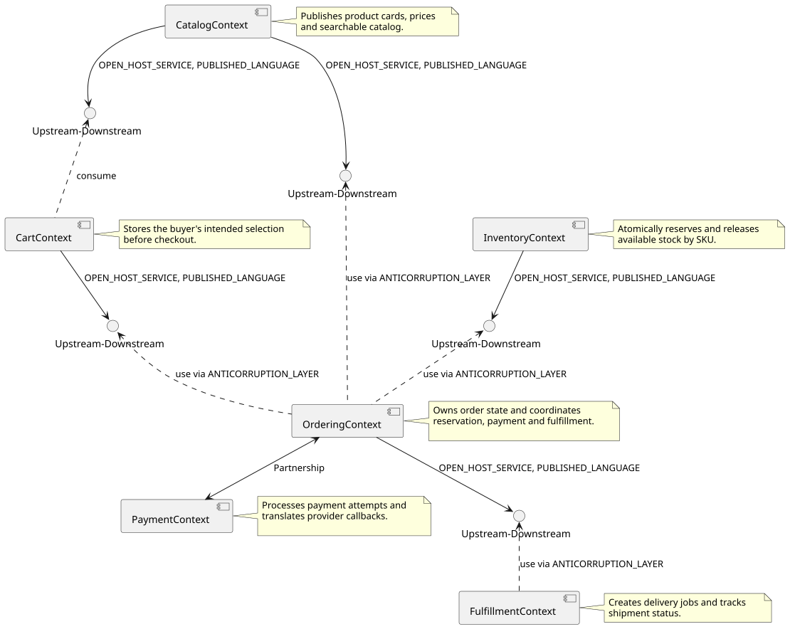
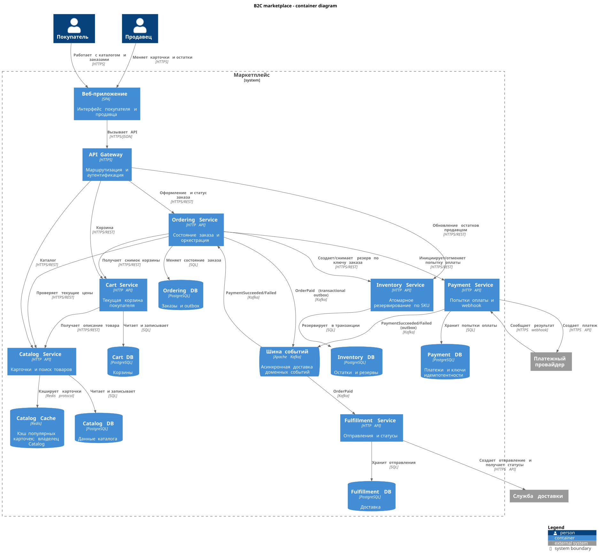

# Лабораторная работа № 1. Архитектура B2C-маркетплейса

**Дисциплина:** Архитектура информационных систем  
**Студент:** Кузьмин Артём Дмитриевич  
**Группа:** ДИФ-15  
**Предметная область:** B2C-маркетплейс (пункт 6 перечня методических рекомендаций).

## Цель и границы проекта

Спроектировать архитектуру системы, в которой покупатель находит товар, кладет его в корзину, оформляет и оплачивает заказ, а продавец поддерживает карточки и остатки. После оплаты система передает отправление службе доставки. Предмет работы - проектирование; исходного кода работающих микросервисов и измерений нагрузки здесь нет.

Внешние участники - покупатель, продавец, платежный провайдер и служба доставки. Платежный провайдер и служба доставки не входят в границы маркетплейса.

## Архитектурно значимые требования (ASR)

Значения ниже - **целевые критерии проектирования**, а не результаты проведенного нагрузочного тестирования.

### ASR-1. Производительность каталога во время распродажи

| Элемент сценария SEI | Значение |
| --- | --- |
| Источник стимула (Source) | Покупатели маркетплейса. |
| Стимул (Stimulus) | Одновременно запрашивают карточки и списки товаров. |
| Артефакт (Artifact) | Catalog Service, его хранилище и кэш. |
| Среда (Environment) | Сезонная распродажа, до 5000 запросов каталога в секунду на входе. |
| Отклик (Response) | Несколько экземпляров Catalog Service обслуживают чтение; популярные карточки выдаются из кэша Catalog Cache, промахи читаются из собственной БД. |
| Метрика отклика (Response Measure) | Для запросов карточки товара p95 времени ответа API не более 300 мс при указанной нагрузке. |

### ASR-2. Целостность остатка при параллельной покупке

| Элемент сценария SEI | Значение |
| --- | --- |
| Источник стимула (Source) | Два покупателя. |
| Стимул (Stimulus) | Одновременно оформляют заказы на последний экземпляр одного SKU. |
| Артефакт (Artifact) | Inventory Service и Inventory DB. |
| Среда (Environment) | Нормальная работа; доступный остаток SKU равен единице. |
| Отклик (Response) | Inventory Service атомарно выполняет условное резервирование в своей транзакции, повторную команду распознает по ключу заказа; второй заказ получает отказ в резервировании и не переходит к оплате. |
| Метрика отклика (Response Measure) | Ровно один успешный резерв для двух конкурирующих запросов; число подтвержденных к оплате единиц не превышает доступный остаток. |

### ASR-3. Доступность оформления при сбое платежного провайдера

| Элемент сценария SEI | Значение |
| --- | --- |
| Источник стимула (Source) | Платежный провайдер. |
| Стимул (Stimulus) | Его API временно не отвечает после создания заказа. |
| Артефакт (Artifact) | Ordering Service, Payment Service, их хранилища и шина событий. |
| Среда (Environment) | Рабочий режим, у заказа уже создан резерв товара. |
| Отклик (Response) | Заказ остается в состоянии `AWAITING_PAYMENT`; попытка оплаты повторяется с тем же ключом идемпотентности. По истечении 15 минут без подтверждения заказ отменяется, резерв освобождается. |
| Метрика отклика (Response Measure) | Данные принятого заказа сохраняются; в течение 15 минут заказ получает подтверждение оплаты или статус отмены, повторные попытки не создают второй платеж за тот же заказ. |

## Контекст системы (C4, уровень 1)



На этой схеме маркетплейс показан как единая система. Покупатель и продавец работают через ее интерфейс, а оплата и физическая доставка выполняются внешними системами. Исходник: [`system-context.puml`](docs/architecture/system-context.puml).

## Доменный анализ и Event Storming

Ниже приведен упорядоченный разбор основного потока. Это результат анализа сценариев предметной области, без утверждения о проведенной сессии с реальными заинтересованными сторонами.

| Шаг | Команда | Событие или результат | Контекст |
| --- | --- | --- | --- |
| 1 | `UpdateProduct`, `ChangeStock` | `ProductUpdated`, `StockChanged` | Catalog, Inventory |
| 2 | `AddToCart` | `CartChanged` | Cart |
| 3 | `PlaceOrder` | `OrderCreated` либо отказ в оформлении | Ordering |
| 4 | `ReserveStock(orderId, sku, qty)` | `StockReserved` либо `StockRejected` | Inventory |
| 5 | `InitiatePayment(orderId)` | `PaymentSucceeded` либо `PaymentFailed` | Payment |
| 6 | `ConfirmOrder`, `CancelOrder` | `OrderPaid` либо `OrderCancelled` | Ordering |
| 7 | `CreateShipment` | `ShipmentCreated`; затем `ShipmentStatusChanged` | Fulfillment |

Два термина имеют разные значения на разных границах. «Товар» в каталоге - карточка с описанием и ценой, в корзине - намерение купить определенное количество, в остатках - учетная позиция SKU с доступным количеством. «Заказ» в Ordering - обязательство и состояние покупки, а в Fulfillment - основание для создания отправления; контекст доставки получает опубликованный снимок, а не читает таблицы заказов.

Резервирование остатка должно быть строго согласованным **внутри Inventory DB**. Переходы между заказом, оплатой и доставкой допускают согласованность в конечном счете: подтверждение приходит через события. Для исключения повторной обработки команды используют идентификатор заказа, события - идентификатор события, а публикация события после транзакции выполняется через transactional outbox. Внешний провайдер должен поддерживать идемпотентный ключ операции; это проектное условие для ASR-3.

### Паспорт Ordering Context (основной поддомен)

| Поле Bounded Context Canvas | Содержание |
| --- | --- |
| Наименование и статус | Ordering Context; **Core Domain**. В CML этот статус задан у `OrderingDomain`, тогда как `type = APPLICATION` описывает уровень самого ограниченного контекста. |
| Ответственность | Жизненный цикл заказа, фиксация цены в заказе, запуск резервирования и оплаты, отмена и публикация `OrderPaid`. |
| Единый язык | **Заказ** - неизменяемый идентификатор и снимок позиций с итоговой суммой; **резерв** - подтвержденное Inventory выделение количества; **оплачен** - состояние после принятого результата платежа. |
| Входящие интерфейсы | `POST /orders` и `GET /orders/{id}` от шлюза; события `PaymentSucceeded/Failed` из Kafka. |
| Исходящие контракты | Запрос снимка корзины, проверка текущих цен в Catalog и команда `ReserveStock` через HTTPS/REST; `InitiatePayment/CancelPayment` через HTTPS/REST; событие `OrderPaid` через Kafka. |
| Бизнес-инварианты | `PAID` допустим только после успешного резерва и подтверждения оплаты; итоговая сумма и состав заказа фиксируются при создании и не зависят от последующих изменений каталога; повторный результат оплаты не меняет заказ второй раз. |

### Паспорт Inventory Context (основной поддомен)

| Поле Bounded Context Canvas | Содержание |
| --- | --- |
| Наименование и статус | Inventory Context; **Core Domain** (`InventoryDomain` в CML). |
| Ответственность | Учет доступного количества по SKU, создание и снятие резервов. |
| Единый язык | **SKU** - учетная позиция; **доступный остаток** - количество, которое можно резервировать; **резерв** - выделение количества для определенного заказа до оплаты или отмены. |
| Входящие интерфейсы | `ReserveStock(orderId, sku, qty)` и `ReleaseStock(orderId)` от Ordering через HTTPS/REST; обновление остатка продавцом через API Gateway. |
| Исходящие контракты | Синхронный ответ `StockReserved/StockRejected`; подтверждение снятия резерва. |
| Бизнес-инварианты | Доступное количество неотрицательно; на один `orderId + sku` существует не более одного активного резерва; резерв и изменение доступного остатка фиксируются одной транзакцией Inventory DB. |

Остальные контексты: Catalog управляет карточками и поиском; Cart хранит выбор покупателя; Payment владеет платежными попытками и переводит webhook провайдера в доменные события; Fulfillment владеет отправлениями и взаимодействием с доставкой. Граница Payment особенно важна: внешнему провайдеру известны платежи, но состояние заказа определяет только Ordering.

## Карта контекстов (DDD, CML)



Исходная модель - [`marketplace.cml`](docs/architecture/marketplace.cml). Ее визуализация [`context-map.puml`](docs/architecture/context-map.puml) **генерируется Context Mapper CLI из CML**. Направление U → D показывает поставщика контракта и потребителя; `OHS/PL` - открытый интерфейс и опубликованный язык, `ACL` - перевод чужой модели на язык потребителя. Ordering и Payment связаны партнерством: совместно согласуют контракт оплаты и обработку результата, сохраняя отдельные модели и БД.

| Поставщик / партнер | Потребитель / партнер | Контракт и смысл границы |
| --- | --- | --- |
| Catalog | Cart | API карточки для отображения в корзине. |
| Catalog | Ordering | Актуальная цена для расчета суммы при оформлении. |
| Cart | Ordering | Снимок корзины при создании заказа; Ordering сохраняет собственный снимок. |
| Inventory | Ordering | Синхронный API резерва и освобождения; Ordering не видит таблиц остатков. |
| Ordering ↔ Payment | Payment ↔ Ordering | Согласованный API инициирования оплаты и событие ее результата. |
| Ordering | Fulfillment | Событие `OrderPaid`, преобразуемое в модель отправления. |

## Контейнеры (C4, уровень 2)



Исходник: [`containers.puml`](docs/architecture/containers.puml). Веб-приложение и API Gateway - общие контейнеры доставки интерфейса. Шесть предметных контекстов отображаются на шесть сервисов. У каждого сервиса собственная PostgreSQL, а Redis-кэш принадлежит только Catalog. Прямых вызовов чужой БД нет. Kafka используется для событий `PaymentSucceeded/Failed` и `OrderPaid`; команды резерва и запуска оплаты остаются синхронными, чтобы быстро вернуть понятный результат оформления. Входящие события обрабатываются идемпотентно. У Ordering и Payment локальная транзакция данных и outbox фиксируются атомарно; отдельный издатель пересылает outbox в Kafka с возможными повторами.

Если резерв не создан, заказ не переходит к оплате. При отказе/тайм-ауте оплаты до завершения окна ожидания Ordering отменяет заказ, сообщает Payment об отмене попытки и отправляет идемпотентную команду снятия резерва. Если подтверждение оплаты приходит уже после отмены, Payment запускает возврат средств и не превращает отмененный заказ в оплаченный. Только событие `OrderPaid` дает Fulfillment основание создать отправление. На схеме Kafka показана как инфраструктурный контейнер; она не является общей предметной БД сервисов.

## Архитектурное решение и результат

Решение и две отклоненные альтернативы зафиксированы в [ADR-002](docs/adr/ADR-002-service-decomposition.md); [реестр ADR](docs/adr/README.md) служит оглавлением. Результат - проектная модель, а не развернутая система. Числовые ASR требуют отдельных нагрузочных и отказоустойчивых испытаний при реализации.

## Воспроизведение и проверка

Нужны Java 17+, Graphviz (`dot`), GNU Make и `curl`. На Linux/macOS/WSL2 в корне репозитория:

```bash
make build-docs
make lint
```

`make build-docs` загружает закрепленные версии Context Mapper CLI 6.12.0 и PlantUML 1.2026.9 в локальный каталог `.tools`, проверяет CML, генерирует `docs/architecture/context-map.puml` из него и рендерит три SVG в `evidence`. `make lint` заново валидирует CML, проверяет синтаксис трех PlantUML-файлов и совпадение зафиксированных SVG с результатом сборки. Зависимости загружаются из официальных репозиториев Context Mapper (Maven Central) и PlantUML (GitHub Releases); исполняемые файлы зависимостей в Git не хранятся.

**Вывод:** логические границы контекстов заданы по смыслу терминов и правилам согласованности. Контейнерная декомпозиция сохраняет эти границы, изолирует хранилища и позволяет масштабировать чтение каталога независимо от оформления заказа.
