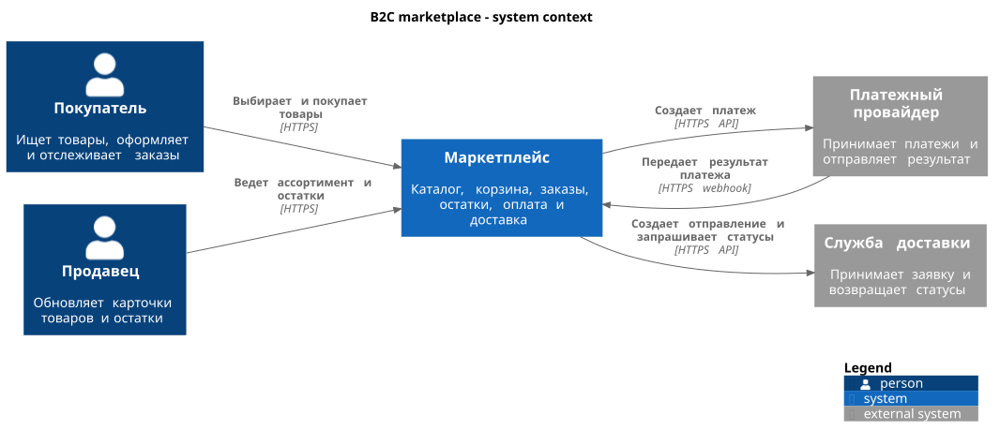
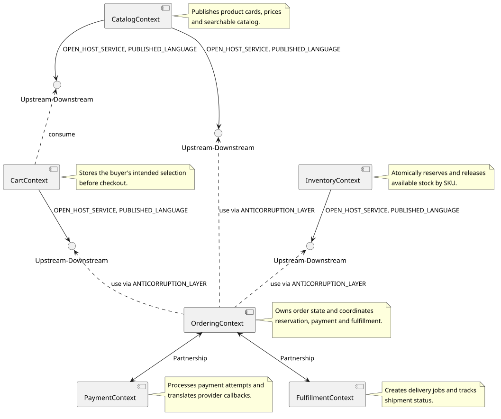
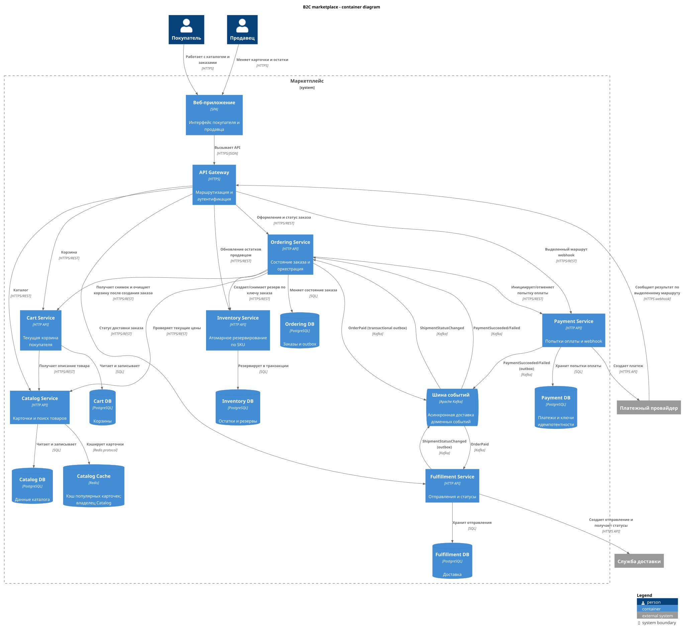

# Архитектура информационных систем: B2C-маркетплейс

**Дисциплина:** Архитектура информационных систем  
**Студент:** Кузьмин Артём Дмитриевич  
**Группа:** ДИФ-15  
**Предметная область:** B2C-маркетплейс (пункт 6 перечня методических рекомендаций).

## Навигация по лабораторным

Это один проект, который развивается от архитектурной модели к коду. Ссылка на `main` открывает текущее состояние. Теги `lab1-complete` и `lab2-complete` сохраняют состояние проекта на момент сдачи каждой работы.

| Работа | Что проверять | Состояние на момент сдачи | Материалы |
| --- | --- | --- | --- |
| № 1 | Архитектура, контексты и решения | [Открыть ЛР № 1](https://github.com/TemonDK/ais-lab1-marketplace/tree/lab1-complete) | [Диаграммы](docs/architecture/), [ADR](docs/adr/), SVG в `evidence/` |
| № 2 | Два сервиса, OpenAPI, шлюз, Pact и Docker Compose | [Открыть ЛР № 2](https://github.com/TemonDK/ais-lab1-marketplace/tree/lab2-complete) | [Отчёт ЛР № 2](README.md#лабораторная-работа--2-контрактное-взаимодействие-catalog-и-cart), [контракт](docs/api/openapi.yaml), [код](src/), [тесты](tests/), [логи](evidence/) |

При проверке конкретной работы открывайте соответствующий тег: так изменения следующих лабораторных не меняют уже сданный результат. Для следующих работ таблица дополняется новой строкой, а новые файлы размещаются по структуре их методичек.

## Лабораторная работа № 1. Архитектура B2C-маркетплейса

### Цель и границы проекта

Спроектировать архитектуру системы, в которой покупатель находит товар, кладет его в корзину, оформляет и оплачивает заказ, а продавец поддерживает карточки и остатки. После оплаты система передает отправление службе доставки. Предмет работы - проектирование; исходного кода работающих микросервисов и измерений нагрузки здесь нет.

Внешние участники - покупатель, продавец, платежный провайдер и служба доставки. Платежный провайдер и служба доставки не входят в границы маркетплейса.

### Архитектурно значимые требования (ASR)

Значения ниже - **целевые критерии проектирования**, а не результаты проведенного нагрузочного тестирования.

#### ASR-1. Производительность каталога во время распродажи

| Элемент сценария SEI | Значение |
| --- | --- |
| Источник стимула (Source) | Покупатели маркетплейса. |
| Стимул (Stimulus) | Одновременно запрашивают карточки и списки товаров. |
| Артефакт (Artifact) | Catalog Service, его хранилище и кэш. |
| Среда (Environment) | Сезонная распродажа, до 5000 запросов каталога в секунду на входе. |
| Отклик (Response) | Несколько экземпляров Catalog Service обслуживают чтение; популярные карточки выдаются из кэша Catalog Cache, промахи читаются из собственной БД. |
| Метрика отклика (Response Measure) | Для запросов карточки товара p95 времени ответа API не более 300 мс при указанной нагрузке. |

#### ASR-2. Целостность остатка при параллельной покупке

| Элемент сценария SEI | Значение |
| --- | --- |
| Источник стимула (Source) | Два покупателя. |
| Стимул (Stimulus) | Одновременно оформляют заказы на последний экземпляр одного SKU. |
| Артефакт (Artifact) | Inventory Service и Inventory DB. |
| Среда (Environment) | Нормальная работа; доступный остаток SKU равен единице. |
| Отклик (Response) | Inventory Service атомарно выполняет условное резервирование в своей транзакции, повторную команду распознает по ключу заказа; второй заказ получает отказ в резервировании и не переходит к оплате. |
| Метрика отклика (Response Measure) | Ровно один успешный резерв для двух конкурирующих запросов; число подтвержденных к оплате единиц не превышает доступный остаток. |

#### ASR-3. Доступность оформления при сбое платежного провайдера

| Элемент сценария SEI | Значение |
| --- | --- |
| Источник стимула (Source) | Платежный провайдер. |
| Стимул (Stimulus) | Его API временно не отвечает после создания заказа. |
| Артефакт (Artifact) | Ordering Service, Payment Service, их хранилища и шина событий. |
| Среда (Environment) | Рабочий режим, у заказа уже создан резерв товара. |
| Отклик (Response) | Заказ остается в состоянии `AWAITING_PAYMENT`; попытка оплаты повторяется с тем же ключом идемпотентности. По истечении 15 минут без подтверждения заказ отменяется, резерв освобождается. |
| Метрика отклика (Response Measure) | Данные принятого заказа сохраняются; в течение 15 минут заказ получает подтверждение оплаты или статус отмены, повторные попытки не создают второй платеж за тот же заказ. |

### Контекст системы (C4, уровень 1)



На этой схеме маркетплейс показан как единая система. Покупатель и продавец работают через ее интерфейс, а оплата и физическая доставка выполняются внешними системами. Исходник: [`system-context.puml`](docs/architecture/system-context.puml).

### Доменный анализ и Event Storming

Ниже приведен упорядоченный разбор основного потока. Это результат анализа сценариев предметной области, без утверждения о проведенной сессии с реальными заинтересованными сторонами.

| Шаг | Команда | Событие или результат | Контекст |
| --- | --- | --- | --- |
| 1 | `UpdateProduct`, `ChangeStock` | `ProductUpdated` (локальное событие и сброс кэша), `StockChanged` (локальное событие) | Catalog, Inventory |
| 2 | `AddToCart` | `CartChanged` (локальное событие) | Cart |
| 3 | `PlaceOrder` | `OrderCreated` (локальное событие) либо отказ в оформлении | Ordering |
| 3а | `ClearCart(orderId, buyerId)` после сохранения заказа | `CartChanged` (локальное событие, идемпотентная очистка снимка) | Cart |
| 4 | `ReserveStock(orderId, sku, qty)` | `StockReserved` либо `StockRejected` (ответ HTTP) | Inventory |
| 5 | `InitiatePayment(orderId)` | `PaymentSucceeded` либо `PaymentFailed` | Payment |
| 6 | `ConfirmOrder`, `CancelOrder` | `OrderPaid` либо `OrderCancelled` | Ordering |
| 7 | `CreateShipment` | `ShipmentCreated` (локальное событие); затем `ShipmentStatusChanged` (Kafka) | Fulfillment |

Два термина имеют разные значения на разных границах. «Товар» в каталоге - карточка с описанием и ценой, в корзине - намерение купить определенное количество, в остатках - учетная позиция SKU с доступным количеством. «Заказ» в Ordering - обязательство и состояние покупки, а в Fulfillment - основание для создания отправления; контекст доставки получает опубликованный снимок, а не читает таблицы заказов.

Резервирование остатка должно быть строго согласованным **внутри Inventory DB**. Переходы между заказом, оплатой и доставкой допускают согласованность в конечном счете: подтверждение приходит через события. Для исключения повторной обработки команды используют идентификатор заказа, события - идентификатор события, а публикация события после транзакции выполняется через transactional outbox. Внешний провайдер должен поддерживать идемпотентный ключ операции; это проектное условие для ASR-3.

#### Паспорт Ordering Context (основной поддомен)

| Поле Bounded Context Canvas | Содержание |
| --- | --- |
| Наименование и статус | Ordering Context; **Core Domain**. В CML этот статус задан у `OrderingDomain`, тогда как `type = APPLICATION` описывает уровень самого ограниченного контекста. |
| Ответственность | Жизненный цикл заказа, фиксация цены в заказе, запуск резервирования и оплаты, отмена и публикация `OrderPaid`. |
| Единый язык | **Заказ** - неизменяемый идентификатор и снимок позиций с итоговой суммой; **резерв** - подтвержденное Inventory выделение количества; **оплачен** - состояние после принятого результата платежа. |
| Входящие интерфейсы | `POST /orders` и `GET /orders/{id}` от шлюза; события `PaymentSucceeded/Failed` и `ShipmentStatusChanged` из Kafka. |
| Исходящие контракты | Запрос снимка и идемпотентная очистка корзины после сохранения заказа, проверка текущих цен в Catalog и команда `ReserveStock` через HTTPS/REST; `InitiatePayment/CancelPayment` через HTTPS/REST; событие `OrderPaid` через Kafka. |
| Бизнес-инварианты | `PAID` допустим только после успешного резерва и подтверждения оплаты; итоговая сумма и состав заказа фиксируются при создании и не зависят от последующих изменений каталога; повторный результат оплаты не меняет заказ второй раз. |

#### Паспорт Inventory Context (основной поддомен)

| Поле Bounded Context Canvas | Содержание |
| --- | --- |
| Наименование и статус | Inventory Context; **Core Domain** (`InventoryDomain` в CML). |
| Ответственность | Учет доступного количества по SKU, создание и снятие резервов. |
| Единый язык | **SKU** - учетная позиция; **доступный остаток** - количество, которое можно резервировать; **резерв** - выделение количества для определенного заказа до оплаты или отмены. |
| Входящие интерфейсы | `ReserveStock(orderId, sku, qty)` и `ReleaseStock(orderId)` от Ordering через HTTPS/REST; обновление остатка продавцом через API Gateway. |
| Исходящие контракты | Синхронный ответ `StockReserved/StockRejected`; подтверждение снятия резерва. |
| Бизнес-инварианты | Доступное количество неотрицательно; на один `orderId + sku` существует не более одного активного резерва; резерв и изменение доступного остатка фиксируются одной транзакцией Inventory DB. |

Остальные контексты: Catalog управляет карточками и поиском; Cart хранит выбор покупателя; Payment владеет платежными попытками и переводит webhook провайдера в доменные события; Fulfillment владеет отправлениями и взаимодействием с доставкой. Граница Payment особенно важна: внешнему провайдеру известны платежи, но состояние заказа определяет только Ordering.

### Карта контекстов (DDD, CML)



Исходная модель - [`marketplace.cml`](docs/architecture/marketplace.cml). Ее визуализация [`context-map.puml`](docs/architecture/context-map.puml) **генерируется Context Mapper CLI из CML**. Направление U → D показывает поставщика контракта и потребителя; `OHS/PL` - открытый интерфейс и опубликованный язык, `ACL` - перевод чужой модели на язык потребителя. Ordering и Payment связаны партнерством: совместно согласуют контракт оплаты и обработку результата, сохраняя отдельные модели и БД.

| Поставщик / партнер | Потребитель / партнер | Контракт и смысл границы |
| --- | --- | --- |
| Catalog | Cart | API карточки для отображения в корзине. |
| Catalog | Ordering | Актуальная цена для расчета суммы при оформлении. |
| Cart | Ordering | Снимок корзины при создании заказа и команда `ClearCart` после сохранения заказа; владелец данных Cart. |
| Inventory | Ordering | Синхронный API резерва и освобождения; Ordering не видит таблиц остатков. |
| Ordering ↔ Payment | Payment ↔ Ordering | Согласованный API инициирования оплаты и событие ее результата. |
| Ordering ↔ Fulfillment | Fulfillment ↔ Ordering | `OrderPaid` создает отправление; `ShipmentStatusChanged` обновляет статус доставки заказа. |

### Контейнеры (C4, уровень 2)



Исходник: [`containers.puml`](docs/architecture/containers.puml). Веб-приложение и API Gateway - общие контейнеры доставки интерфейса. Шесть предметных контекстов отображаются на шесть сервисов. У каждого сервиса собственная PostgreSQL, а Redis-кэш принадлежит только Catalog. Прямых вызовов чужой БД нет. Kafka используется для событий `PaymentSucceeded/Failed`, `OrderPaid` и `ShipmentStatusChanged`; команды резерва и запуска оплаты остаются синхронными, чтобы быстро вернуть понятный результат оформления. Входящие события обрабатываются идемпотентно. У Ordering и Payment локальная транзакция данных и outbox фиксируются атомарно; отдельный издатель пересылает outbox в Kafka с возможными повторами.

Если резерв не создан, заказ не переходит к оплате. При отказе/тайм-ауте оплаты до завершения окна ожидания Ordering отменяет заказ, сообщает Payment об отмене попытки и отправляет идемпотентную команду снятия резерва. Если `CancelPayment` приходит после успешного платежа, Payment проверяет его состояние и запускает идемпотентный возврат. Получив `PaymentSucceeded` для уже отмененного заказа, Ordering повторяет `CancelPayment` даже при задержке первой команды. Заказ не становится оплаченным. После сохранения заказа Ordering отправляет Cart команду `ClearCart` с идентификатором заказа: она удаляет только позиции из исходного снимка, чтобы не стереть новые покупки. Только событие `OrderPaid` дает Fulfillment основание создать отправление. Fulfillment публикует `ShipmentStatusChanged`, Ordering подписывается на него и отдает статус заказа через API Gateway. Webhook провайдера идет через выделенный маршрут API Gateway к Payment, где проверяется подпись. На схеме Kafka показана как инфраструктурный контейнер; она не является общей предметной БД сервисов.

### Архитектурное решение и результат

Решение и две отклоненные альтернативы зафиксированы в [ADR-002](docs/adr/ADR-002-service-decomposition.md); [реестр ADR](docs/adr/README.md) служит оглавлением. Результат - проектная модель, а не развернутая система. Числовые ASR требуют отдельных нагрузочных и отказоустойчивых испытаний при реализации.

### Воспроизведение и проверка

Нужны Java 17+, Graphviz (`dot`), Python 3, GNU Make и `curl`. На Linux/macOS/WSL2 в корне репозитория:

```bash
make build-docs
make lint
```

`make build-docs` загружает закрепленные версии Context Mapper CLI 6.12.0 и PlantUML 1.2026.9 в локальный каталог `.tools`, проверяет CML, генерирует `docs/architecture/context-map.puml` из него и рендерит три SVG в `evidence`. `make lint` заново валидирует CML, проверяет синтаксис трех PlantUML-файлов, сверяет с CML исходный файл карты контекстов и проверяет XML-структуру созданных и сохранённых SVG. Зависимости загружаются из официальных репозиториев Context Mapper (Maven Central) и PlantUML (GitHub Releases); исполняемые файлы зависимостей в Git не хранятся.

**Вывод:** логические границы контекстов заданы по смыслу терминов и правилам согласованности. Контейнерная декомпозиция сохраняет эти границы, изолирует хранилища и позволяет масштабировать чтение каталога независимо от оформления заказа.

## Лабораторная работа № 2. Контрактное взаимодействие Catalog и Cart

**Студент:** Кузьмин Артём Дмитриевич, ДИФ-15. **Цель:** реализовать часть спроектированного маркетплейса как работающие сервисы и проверить их контракт.

| Роль | Контейнер из ЛР № 1 | Реализация |
| --- | --- | --- |
| Provider | Catalog Service | Spring Boot 3, PostgreSQL; создание, обновление и чтение товара по SKU. |
| Consumer | Cart Service | Spring Boot 3, PostgreSQL; HTTP/REST запрос карточки товара в Catalog при добавлении позиции. |
| Общий вход | API Gateway | Spring Cloud Gateway, Redis Token Bucket, 5 запросов/сек на IP и маршрут. |

Пара `Cart → Catalog` уже показана на диаграмме контейнеров ЛР № 1. Это учебный исполняемый срез архитектуры: Ordering, Payment, Inventory, Fulfillment и Kafka пока остаются проектными частями. Redis этого среза хранит только счетчики квот шлюза; предусмотренный в полной архитектуре кэш каталога еще не реализован. Ни на одном сервисе нет опубликованного наружу порта; публичный вход только на шлюзе `:8080`.

### Контракт и границы данных

[Спецификация OpenAPI 3.1](docs/api/openapi.yaml) создана для Catalog Service. `POST /api/catalog/products` создает карточку (201), `GET /api/catalog/products/{sku}` читает активную карточку (200) или отклоняет неактивную (422), `PUT /api/catalog/products/{sku}` обновляет (200). Внутренние пути Catalog: `/products` и `/products/{sku}`. `POST /api/cart/carts/{buyerId}/items` запрашивает товар у Catalog по HTTP, обрабатывает отказ 422 при неактивном товаре, сохраняет снимок цены и названия в собственной базе и возвращает корзину (201). `GET /api/cart/carts/{buyerId}` читает корзину; `DELETE` того же адреса очищает ее (204). Очистка в ЛР № 2 демонстрационная; согласованную по снимку команду `ClearCart(orderId, buyerId)` для Ordering предстоит реализовать при добавлении сервиса заказов. Данные PostgreSQL изолированы между Catalog и Cart.

Некорректные JSON и параметры дают 400, отсутствующий товар 404, повтор SKU и неактивный товар 422, недоступный Catalog для Cart 502. Сервисы возвращают `application/problem+json` по RFC 7807. Квота 5 токенов/сек и емкость 5 токенов заданы отдельно для маршрутов Catalog и Cart; превышение дает 429 с ProblemDetails. Один IP означает общий ключ для запросов этого IP к соответствующему маршруту.

### Запуск и проверка

На Linux/WSL2 нужны Docker Engine с Compose, `curl`, Python 3 и `make`. Из корня репозитория:

```bash
make up
make test-api
make rate-limit
# Спецификация и Swagger UI доступны на http://localhost:8080/docs
make down
```

`make up` равнозначен `docker compose up -d --build`. Без `make`: `docker compose up --build`. Шлюз доступен по `http://localhost:8080`, документация по `http://localhost:8080/docs`, исходный контракт по `/openapi.yaml`. Маршруты документации не занимают квоту бизнес API. `tests/test-api.sh` проверяет реальные ответы, отсутствие обязательного поля, данные корзины и доступность Swagger UI и OpenAPI через шлюз, `tests/rate-limit-demo.sh` отправляет 30 быстрых запросов и требует наличие HTTP 429 с телом ProblemDetails. В `evidence/` опубликованы протоколы только успешных фактических прогонов, а в `tests/pact/pacts/` файл, созданный consumer-тестом.

Отдельные JUnit-тесты проверяют бизнес-отказы Cart без записи в БД, а интеграционные тесты Catalog с PostgreSQL проверяют создание товара, обновление, отказ 422, ошибки 400 и 404. Для Pact consumer-тест использует HTTP-клиент Cart с Pact Mock Server и формирует `cart-service-catalog-service.json`; provider-тест поднимает **настоящий Catalog Service** и сверяет его ответы с этим файлом (предусловия `product SKU-123 exists` и `product SKU-OFF is inactive`); проверяются успешный ответ 200 и доменный отказ 422. Команда `make pact` требует Maven, JDK 21 и запущенную локальную PostgreSQL Catalog на `localhost:5433`. В GitHub Actions тест запускается с отдельным PostgreSQL, затем проверяется Docker Compose. Логи сохраняются как `evidence/pact-consumer-test.log`, `pact-provider-verification.log`, `test-api-run.log`, `rate-limit-demo-run.log`, `docker-compose-ps.log`. Метка `lab1-complete` фиксирует принятую ЛР № 1; `lab2-complete` отмечает первый законченный вариант ЛР № 2, а `lab2-verified` указывает на итоговую версию после проверки и исправлений.

**Вывод:** синхронный контракт Catalog → Cart позволяет добавлять в корзину только существующий активный товар, сохраняя собственный снимок его цены. Шлюз отделяет внешний трафик от сервисов и ограничивает нагрузку, а Pact проверяет совместимость реальных HTTP ответов с ожиданиями клиента.
